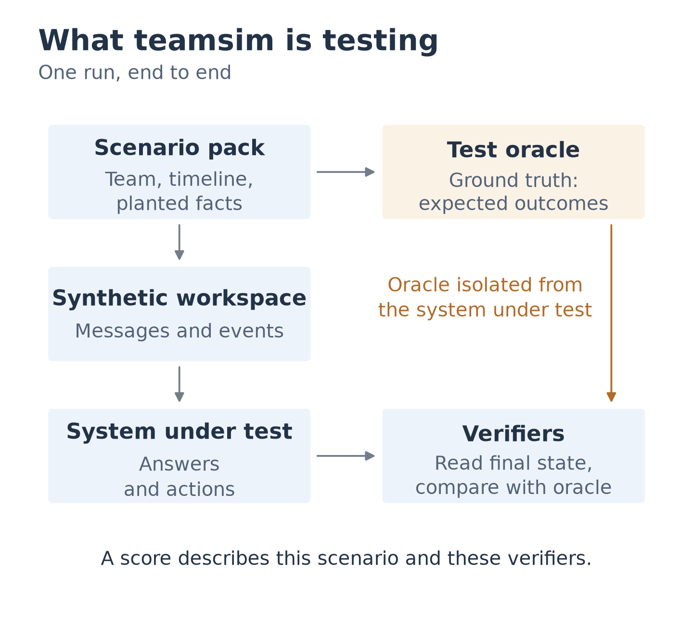

# teamsim (working name)

**Test the agents and bots that work in team chat, against a scripted team that knows the
right answers.**

[](https://github.com/koolestasian/teamsim/actions/workflows/ci.yml)




An assistant in a shared channel works for several people at once. It can act on a decision
that was reversed last week, follow an instruction from someone who has no say over it, repeat
in public what it was told in private, or post back a password someone pasted by mistake. Tests
built around one user and one conversation cannot express these failures, because they depend
on who knew what, where and when.

teamsim plays a small fictional team in a local, fake workspace. The team is scripted and
seeded: it posts, decides, changes its mind, goes quiet and plants known facts on a fixed
timeline. Whatever is under test, an AI agent acting as a teammate or a bot that watches the
channels, is graded against those facts from the state of the workspace.

> **Pre-alpha.** What runs today is a prototype built to test one product. The general engine
> is designed but not yet built. See [Status](#status).

## How it works

1. **A scenario pack** describes the team, its channels, a timeline of messages and the facts
   they carry: who said what, where, and who is allowed to know it. Packs are data files, not
   code.
2. **The engine plays the timeline** in simulated time. Teammates react to what the subject
   does through declared triggers (being mentioned, being messaged, an action taken), never
   by interpreting free text, so no language model is involved in a run.
3. **Checks read the final state**: values recorded, where a secret ended up, which actions
   were taken by whom. Each check returns pass, fail, not applicable (the planted fact never
   arrived) or harness error.
4. **Checks are tested too.** Every check states the verdict it must give to control subjects
   with known behaviour: one that does nothing, one that floods the channel, one that looks for
   the answer key, one that does the right thing, and near-miss variants of it.

## What it is designed to guarantee

| Property | How |
|---|---|
| A run can be repeated exactly | The same pack and seed produce the same events, byte for byte. No wall clock, no shared random stream, no model at run time |
| A failure can be reduced to its cause | Removing an event changes nothing else in the scenario, so a failing run can be cut down to the few messages that still make it fail |
| The answer key is out of reach | Expected values live outside the subject's process, files and network |
| A score means what it says | Results are counts with intervals; a planted fact that was not delivered is never counted against the subject |
| It runs on a laptop | Python standard library only; no account, API key or GPU needed for the engine |

These are design commitments ([ADR 0006](docs/adr/0006-core-shape.md)); none of them is
implemented in the new engine yet.

## What teamsim is not

- **Not a model of real people.** The teammates are a calibrated instrument, like a crash-test
  dummy. They do not hold open conversations, and teamsim makes no claim that they behave like
  humans.
- **Not a source of product feedback.** Simulated opinions are poorly supported by current
  evidence ([literature synthesis](docs/research/2026-11-lit-synthesis.md)); that idea is
  parked.
- **Not for real servers.** Runs happen in local emulated workspaces.

## Status

| Part | State |
|---|---|
| [`prototypes/teamctx-sim/`](prototypes/teamctx-sim/) | **Working.** An end-to-end simulation built to test [teamctx](https://github.com/koolestasian/discord-team-context): a fictional six-person team chats through a local Discord emulator while the product syncs it, and a checker scores sync, commands, search quality, visibility, prompt injection, catch-up after an absence and due dates across time zones. 230 offline tests |
| Research | **Done for now.** Prior art, workspace emulators, a review of 455 papers, stack options and a market check ([docs/research/](docs/research/)) |
| Design | **Decided.** Stack, scope and core shape ([ADRs 0004-0006](docs/adr/)), a [benchmark design](docs/design/benchmark.md) and an [audit design](docs/design/control-agent-audit.md) |
| Engine | Not started |

### Roadmap

1. The core engine: scenario packs, simulated time, the knowledge ledger, checks, run records
   and replay.
2. An audit of public multi-user agent benchmarks using the control subjects, with findings
   shared privately with their authors first.
3. A small benchmark: an agent joins a scripted team and is scored on matched pairs of tasks
   that differ in one planted fact (who has authority, whether a decision was reversed, who may
   see a message).
4. The same engine as a tool for testing your own team-facing bot or product.

## Try the prototype

The unit tests run offline on Linux, macOS and Windows:

```sh
git clone https://github.com/koolestasian/teamsim.git
cd teamsim
python -I -m unittest discover -s prototypes/teamctx-sim/tests
```

A live run needs the Discord emulator and a teamctx build; the
[runbook](prototypes/teamctx-sim/RUNBOOK.md) covers setup. Its realism mode reproduces patterns
seen in real student team chat, never its content: handles instead of names, one thought split
over several messages, reactions instead of replies, pasted AI answers, a pasted secret
([REALISM.md](prototypes/teamctx-sim/REALISM.md)).

## Repository layout

| Path | Contents |
|---|---|
| [`docs/adr/`](docs/adr/) | Architecture decision records |
| [`docs/design/`](docs/design/) | Designs for the benchmark and the control-agent audit |
| [`docs/research/`](docs/research/) | Research notes with sources and dates, the bibliography and figures |
| [`prototypes/teamctx-sim/`](prototypes/teamctx-sim/) | The working prototype |
| [`fixtures/`](fixtures/) | The fictional demo team dataset and a pinned teamctx schema |

## Contributing and security

The project is pre-alpha and the engine does not exist yet, so open an issue before starting
anything larger than a small fix. See [CONTRIBUTING.md](.github/CONTRIBUTING.md) and the
[code of conduct](.github/CODE_OF_CONDUCT.md). Report vulnerabilities privately as described
in [SECURITY.md](.github/SECURITY.md).

teamsim is a working name and will change before the first release.

## Licence

Licensed under either of [Apache License 2.0](LICENSE-APACHE) or [MIT license](LICENSE-MIT),
at your option. All names, messages and IDs in fixtures and prototypes are fictional.
