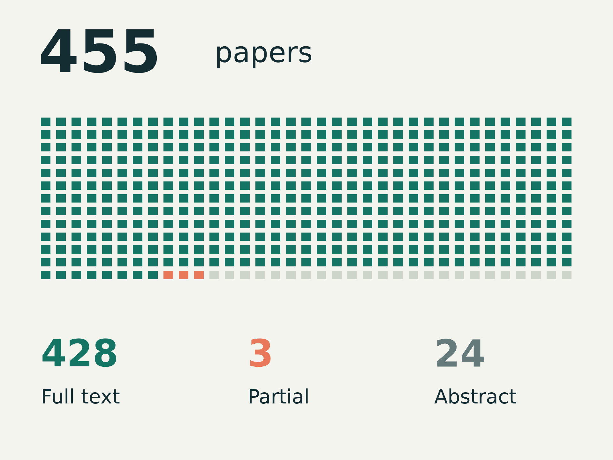

# Full-text check of the literature notes (2026-11-12)

The seven literature notes and the synthesis (2026-11-11) were written mostly from abstracts and
partial reads: 77 of 451 papers were read in full. This note records how every cited paper was
then checked using the available text, how far that check can be
trusted, and what changed.

## Summary

- The model reader processed available full text for 431 of 455 cited papers, classifying
  428 as complete and 3 as partial or protocol-only. The other 24 are
  paywalled journal papers checked from the abstract only. `bibliography/papers.csv` has a
  `read_depth` column per paper.
- The main run produced 1,555 passage-claim verdicts. After the second-reader stage, 86 were
  flagged as not in the paper (59), not supported (20) or contradicted (7); another 624 were
  partly supported. These are candidate corrections, not 710 established errors: some
  passages were attached to the wrong paper, and some caveats did not require an edit.
- The notes were corrected; see "What changed" below and the CHANGELOG.
- The method was benchmarked against a reference reader before it was used. On the
  claims that matter it agreed with that model 93% of the time (95% interval 81-97%), caught
  every planted error and raised no false alarms in this small benchmark. Reader quotes
  matched the extracted text after normalisation. It cost about
  $0.04 per paper instead of about $0.25.

## Method

Fetching, passage extraction, aggregation and quote matching are scripted. Model readers
process one paper at a time; editors and the synthesis author also read whole notes.

1. **Text.** arXiv HTML where available, otherwise the PDF converted to text; open-access copies
   found through OpenAlex as a second chance. References are cut. Paper text is not stored in
   this repository (copyright).
2. **Passages.** A script extracts every passage in the notes that cites the paper (at most 12 per
   paper), with the note and section it comes from.
3. **Reader.** One model call per paper (Claude Haiku 5.5): the full text plus the passages in,
   a structured card out (JSON schema): summary, study type, sample, findings and limitations
   each with a verbatim quote, and one verdict per passage claim: `supported`,
   `partly_supported`, `not_supported`, `contradicted`, `not_in_paper` or `about_other_paper`
   (the passage is about a different paper next to the citation), with a quote and a fix.
   The call has no tools and no web access; the paper text is marked as data, not instructions.
4. **Quote check.** A script checks every quote against the paper text after normalising
   whitespace, quotes, dashes and PDF hyphenation. A separate presence check looks for numbers
   in the quote or paper; neither check establishes that a number has the right denominator,
   belongs to the claim, or supports its interpretation.
5. **Judge.** Every card with a verdict that would change a note (`not_supported`,
   `contradicted`, `not_in_paper`) goes to a second reader (Claude Sonnet 5.5) with the full text
   and the first reader's verdicts, which it upholds or overrules with its own quote.
6. **Corrections.** Final verdicts other than `supported` and `about_other_paper` were applied to
   the notes by an editor working from the verdict, the fix, the verified quote and the paper
   text, with these rules: every flagged claim is restated, moved to the paper that supports it
   (only if already cited in that note) or removed; a `partly_supported` claim is changed only
   when the wording would mislead (wrong number, direction, model or setting, or an overclaim);
   no unsupported citations or numbers. Decisions are logged per candidate correction;
   several entries can describe one edit. A supplementary source check is described below.

## Benchmark

Before the production run, five configurations were compared on 16 papers chosen across the
notes, with 105 items:

- **41 real passages** from the notes. There is no ground truth for these, so the reference is
  Claude Opus 5.5 run with the same prompt; its noise floor is a second, independent Opus run on
  8 of the papers.
- **64 planted passages** whose answer is known by construction: 16 true sentences copied from
  the paper (controls), 16 with a number changed, 16 with a direction word flipped
  ("increased" to "decreased"), and 16 true sentences from a different paper.

| Configuration | Real claims: pass/flag agreement with Opus | Exact verdict | Planted errors caught | False alarms on controls | Reference-finding quote proximity | Reader quotes matched | USD per paper (benchmark) |
|---|---|---|---|---|---|---|---|
| Opus, second run | 100% (n=23) | 83% | 100% | 0% | 94-98% | 100% | 0.23-0.26 |
| Sonnet reader | 93% | 63% | 88-100% | 0% | 82% | 100% | 0.106 |
| Haiku reader | 85% | 66% | 100% | 0% | 88% | 100% | 0.017 |
| Haiku reader + Haiku judge | 88% | 68% | 100% | 0% | 88% | 100% | 0.024 |
| **Haiku reader + Sonnet judge (used)** | **93%** [81-97] | **73%** | **100%** (48/48) | **0%** (0/16) | **88%** | **100%** | 0.088 |

Brackets are Wilson 95% intervals for the reported item proportions; n=41 unless noted.
Items within a paper share context, so these intervals do not account for paper clustering.
Benchmark cost per paper is higher than
production cost because every benchmark paper carries planted errors, so the judge always runs.

The scorer treats `supported`, `partly_supported` and `about_other_paper` as pass for real
passages; the other three labels are flags. Thus pass/flag agreement does not measure agreement
on whether a partly supported claim needs editing. For planted errors, any verdict other than
`supported` counts as detection. The 88% finding-coverage measure is a proxy: a reader quote
starts within 600 characters of a reference finding's quote. It does not measure semantic
recall of findings. Reader quote matching uses normalised extracted text, not exact PDF bytes,
and the benchmark quote column does not include judge quotes.

The earlier benchmark review classified the three disagreements as two granularity differences
and one extraction artifact: in two, the reader gave one `partly_supported` verdict to a
passage with several claims and its fix already said the numbers were not in the paper, where
Opus split the passage and called the numbers `not_in_paper`; the third was a table about other
papers picked up by the passage extractor, which the reader called `about_other_paper` and Opus
`not_in_paper`. That review is a qualitative assessment, not an independent human gold set.
Agreement was 38/41, below Opus's 23/23 self-agreement on its smaller repeat subset. Overlapping
intervals do not establish equivalence or non-inferiority. The chosen pipeline is a cost-saving
screening method; benchmark parity has not been demonstrated.

Two scorer bugs were found by inspecting surprising numbers and fixed before the decision: one
read passage labels written in a different format as missing (it made the Haiku reader look like
it caught 38% of planted errors), the other ranked `about_other_paper` as `supported`.

## Production run

| | |
|---|---|
| Papers with full text | 431 (428 complete, 3 partial) |
| Abstract only (paywalled) | 24 |
| Passage checks | 1,555 |
| Reader quotes checked by script | 7,544; 7,475 (99.1%) matched the normalised extracted text; 69 did not and remain unverified |
| Flags sent to the judge | 167 in 110 papers; 89 overruled (most to `about_other_paper` or `partly_supported`) |
| Final verdicts | 498 supported, 624 partly supported, 347 about another paper, 59 not in paper, 20 not supported, 7 contradicted |
| Cost (CLI-reported API-equivalent USD) | reader $7.54, judge $9.39: $16.93, about $0.04 per paper; excludes benchmark, earlier reader version, editing and supplementary checks |

The reader flagged five title differences and three incomplete or protocol-only texts.
Earlier review attributed the title differences to preprint versions. These are reader and
editor assessments, not an independent completeness audit of every PDF. The partial-text
entries are marked in the bibliography. Unmatched quotes can reflect extraction or quotation
errors; this review does not establish that all 69 failures are harmless PDF noise.

## Extraction coverage and supplementary checks

The first extractor matched surnames and exact years and capped passages at 12 per paper.
It missed 19 of 493 bibliography paper-note pairs (3.9%), chiefly year differences and
year-free citations. Pair coverage does not establish that every claim was extracted.

A second extraction produced 16 additional reader cards with 107 verdicts and 283 quote
matches out of 283 checks. Two further calls failed at a session usage limit; supplementary
Sonnet judging was not run. The continuation editor checked the attributable claims in all
18 pairs with cached full text directly against those sources, including the two without
additional cards. One remaining pair is paywalled and remains abstract-only. Some entries
occur only in a source list, with no attributable body claim to correct.

Of 45 supplementary candidate corrections, source review applied 13, skipped 6 and rejected
26, mostly wrong-paper attachments or passages that described the review's own scope.
For example, a proposed correction would have removed MuPPET's PrivacyChecker utility cost
because the original PrivacyChecker paper reports preserved helpfulness. MuPPET actually
evaluates an implementation and reports a trade-off. Both findings remain attributed to
their own studies. These supplementary decisions were not scored in the model benchmark
and are not included in the main run's 1,555 verdicts. The extra reader calls cost $0.28
API-equivalent, excluding editorial work.

## What changed

The main editorial logs cover 710 candidate corrections across 11 notes. The table counts
logged decisions, not distinct edits or proven source errors. Review restored venue labels
where independent venue evidence supported them; absence from a preprint was not treated as
proof against publication.

| Note | Applied | Skipped | Rejected |
|---|---:|---:|---:|
| Simulated people | 74 | 22 | 14 |
| Evaluation methods | 78 | 20 | 13 |
| Personas, literature | 99 | 30 | 6 |
| Team dynamics | 78 | 27 | 7 |
| Chat realism | 29 | 25 | 4 |
| Scenario testing | 34 | 19 | 2 |
| Product checks | 54 | 31 | 1 |
| Personas, original note | 8 | 6 | 3 |
| Prior art | 10 | 12 | 2 |
| Emulators | 0 | 1 | 0 |
| Prototype audit | 0 | 0 | 1 |
| **Total** | **464** | **193** | **53** |

The 53 rejected entries include misattributed passages and corrections contradicted by
source evidence; they are not 53 errors in the notes. The supplementary decisions above
are separate from this table. Changes that affect decisions include:

- **Feedback:** UX results are scoped to two apps and a small human comparison, with prompts
  developed on the evaluated screens. Defect finding remains a pilot to validate.
- **Personas:** self-report agreement is distinguished from behaviour. Small-model wording
  and a universal 7-8B eligibility floor are not established by the cited studies. Prompt
  guards are model-dependent.
- **Team dynamics:** the 41.1% expert result is a gap to an oracle, not to the best teammate.
  Handoff and reversal checks are identified as design proposals; the hidden-profile
  direction has stronger support than their real-world rates.
- **Evaluation:** the user-model score gap is retained with its single-domain limits.
  Prediction averaging is per question and temperature-dependent. The synthesis explains
  that inactive controls can correctly pass required-abstention cases.
- **Chat:** 37.7% uses answered starters as its denominator; disentanglement agreement
  between annotators is separated from model F1. Help-room rates are not universal team rates.
- **Scenario testing:** driving's layers are useful without calling scenario description
  solved. Judge sensitivity is scoped to the tested construct edits, and RAG oracle scores
  are attributed to their datasets.
- **Product checks:** SlackBench is separated from memory benchmarks with temporal and update
  categories. Group privacy results do not establish a causal audience-size curve. The VR
  re-engagement result belongs to a 30-person evaluation, separate from its formative study.
- **Synthesis:** each agreement and decision now states evidence strength and transfer limits;
  benchmark novelty, aggregate privacy and numerical gate proposals are qualified.

Depth tags in the older notes record their initial reading pass unless explicitly updated.
The bibliography's `read_depth` column and this note describe the subsequent source access.

## Limits

- The reference is a model, not a human expert. Opus agreed with itself on pass/flag for every
  real passage but gave the same exact verdict only 83% of the time, so the finer verdict labels
  are noisy for any reader.
- The benchmark is small (16 papers, 41 real passages); its intervals are wide.
- The reference and screening readers are related models, and the benchmark was also used
  to choose the pipeline. There is no independent held-out human evaluation of reader parity.
- A passage the reader marks `supported` or `partly_supported` is not sent to the judge, so a
  missed error there stays missed. Agreement on real passages and detection of planted errors
  provide limited evidence about this risk; neither estimates missed production errors.
- Evidence-strength and study-type labels on each card are the reader's own and were not
  benchmarked; the synthesis uses them as a guide, not as a grade.
- 24 paywalled papers are still checked from the abstract only.
- Full-text access, quote presence, editorial review and benchmark agreement are separate
  measurements. None certifies that every conclusion in the notes is correct.
- Venue status was not systematically re-checked. Selected labels removed by editors were
  checked externally and restored; this is not a complete publication-status audit.
