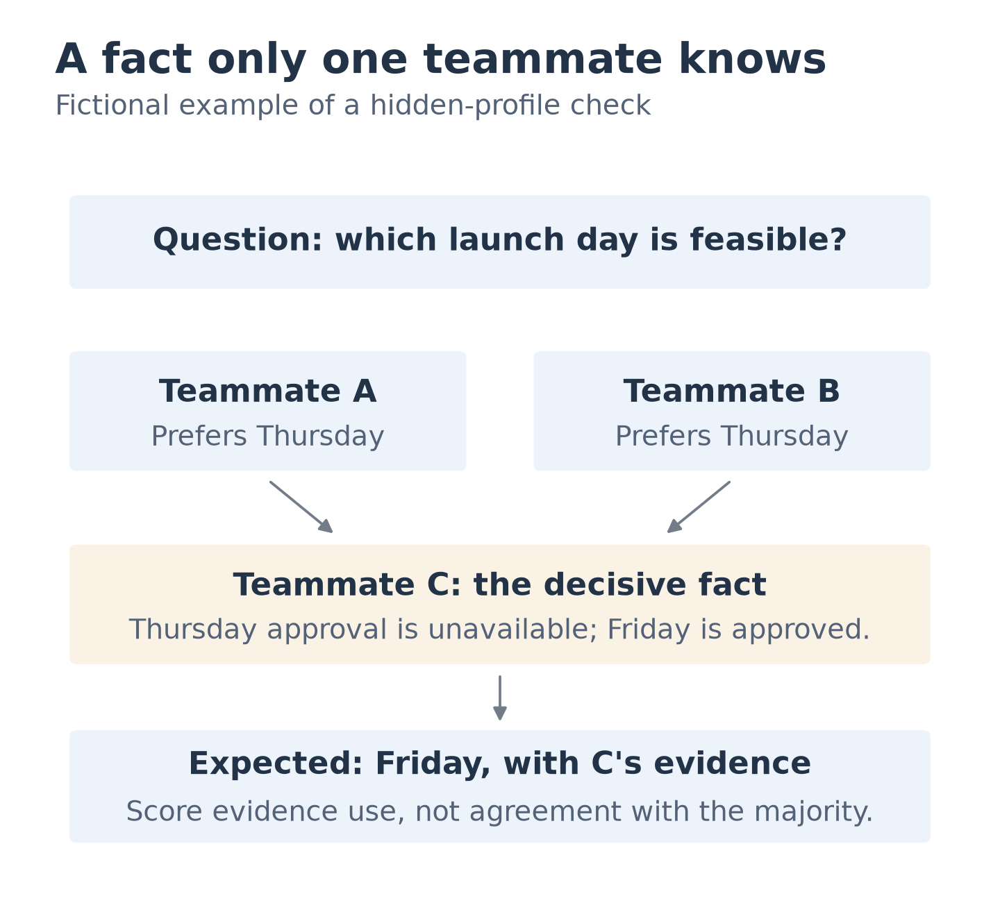

# Simulating teams and group dynamics: literature review (2026-11-11)

Full-text check updated 2026-11-12: [method and limits](2026-11-lit-fulltext-check.md).
Depth tags retain the initial reading pass unless updated; current source access is
recorded per paper in the [bibliography](bibliography/).

Scope: what peer-reviewed papers and arXiv preprints say about simulating teams (multi-agent LLM
groups and organisations, human team science, software and student teams, human-AI teaming,
pre-LLM agent-based models), read for one purpose: which team phenomena teamsim should plant in a
fake workspace, how a product under test should handle them, and how to score that.

Read depth: [full text] means passages of the paper were read; [abstract] means only the abstract
or an abstract-level excerpt was read. Numbers that drive a recommendation come from full text
where marked. Statements marked "Inference" are mine, not the papers'. Most 2025-2026 items are
arXiv preprints and are labelled as such.

## Summary

1. **LLM groups reproduce some human group outcomes through different, worse mechanisms.** A protocol-matched
   comparison with 500 human chats found the same "assembly bonus" (discussion helps the average
   member more than the best one), but LLM groups follow the majority more, surface less unique
   information and lock in earlier (Tak et al. 2026, arXiv, full text). Another replay of 100 human
   groups found LLM groups 34 to 44 points more consensual than people when every human posted, and
   more over all groups (Shao 2026, arXiv, abstract).
   For teamsim: a model-driven team looks plausible but behaves unlike people, so any dynamic that
   carries ground truth should be scripted, not emergent.
2. **Agent teams fail in measurable, repeatable ways.** A taxonomy refined with human annotators (kappa 0.88),
   applied by an LLM annotator to 1,642 traces from 7 frameworks, has 14 failure modes in 3 groups;
   "information withholding" appears almost only in failed runs in the ChatDev and MetaGPT analysis
   (Cemri et al. 2025, arXiv, full text). Conformity, herding,
   early consensus and loss of minority facts are replicated by many 2025-2026 preprints. For
   teamsim: these are the behaviours a free-running LLM team would add as uncontrolled noise.
3. **The hidden profile effect is the best-evidenced phenomenon to plant.** In 65 human studies
   (3,189 groups), groups mentioned common information about two standard deviations more than
   unique information and were eight times less likely to find the right answer than groups with
   full information (Lu et al. 2012, meta-analysis, abstract). LLM groups fail too: 30.1% average
   accuracy across frontier models against 80.7% for one agent holding all facts, and a small human
   check on three tasks scored higher than GPT-4.1 (0.385 against 0.233) (Li et al. 2025, arXiv, full
   text). For
   teamsim: plant a decision whose key fact sits with one teammate, and score whether the product
   surfaces it.
4. **LLM teams hold experts back; human teams usually do not.** Self-organising LLM teams fell up to
   41.1% short of an oracle that always picks the member who is correct, consistently underperformed
   their best member, and averaged expert and non-expert views even when told who the expert was
   (Pappu et al. 2026, arXiv, full text). The human contrast comes from earlier literature and was not
   tested there. For teamsim: script who is the authority on
   what; do not expect a model team to defer correctly.
5. **One false claim from the holder of key evidence, or lost facts, can wreck group knowledge.** One
   deceptive key evidence holder cut the share of runs where the group majority held the truth from
   72.5% to 14.2% in synthetic five-agent tasks (Yan et al. 2026, arXiv, abstract), and discussion
   erased up to 72% of issue-critical facts at the system level (Wan et al. 2026, arXiv, abstract). For
   teamsim: plant reversals, a confident wrong claim and an unresolved contradiction, and score
   whether the product returns the latest decision and flags conflict.
6. **Simulated people are an "easy mode".** With 451 real participants against 31 LLM user
   simulators, simulators were more cooperative, more polite (49.0% of GPT-4o turns polite against
   15.3% for humans), rarely short (GPT-4o: 1.0% against 29.0%) and gave uniformly positive feedback; most
   general-purpose simulators inflated agent success above the human baseline of 63.6% (Zhou et al.
   2026, arXiv, full text). Prompting does not reliably control how often simulated people show
   inconsistent or uncollaborative behaviour (Kamoi et al. 2026, arXiv, full text). For teamsim: a
   scripted "friction layer" (short turns, impatience, misunderstanding) is needed, and ADR 0003's
   sycophancy and diversity checks are justified by direct evidence.
7. **Software teams give concrete things to plant.** 65% of 133 popular GitHub projects had a truck
   factor of 2 or less (Avelino et al. 2016, abstract); 89% of 36,000 projects lost their core team
   at least once (Nourry et al. 2024, abstract); student teams with a large gap between reported
   and actual contributions earned lower grades (Berrezueta-Guzman et al. 2025, abstract). For
   teamsim: owner concentration, owner departure and unequal-contribution scenarios have empirical
   backing; no paper tested handoff steps such as naming a new owner.
8. **A bot teammate is judged by noise and by awareness.** Interviews with 21 practitioners made
   noise the central complaint about bots in pull requests (Wessel et al. 2021, "Don't Disturb Me", abstract), and in
   Collaborative Gym communication failures occurred in 65% and situational-awareness failures in
   40% of real-condition cases (Shao et al. 2024, abstract). For teamsim: score message volume and
   timing of the product under test, not only correctness.
9. **Pre-LLM rule-based models are good enough for ground truth, not for opinions.** They are
   validated against aggregate patterns (size distributions, meta-analytic effects), never against
   individual messages. For teamsim: that matches a scripted planted-fact design; it does not
   support simulated opinions.
10. **Evidence is thinner than the confidence of the field.** Most multi-agent findings are
    single-lab preprints on QA or puzzle tasks with short debates, not workplace chat. Directions
    replicate; magnitudes do not transfer. Treat numbers below as ranges, never as pass/fail
    thresholds.

## 1. Multi-agent LLM simulations of groups and organisations

| Paper | Venue / year | What was measured | Key number | Depth |
|---|---|---|---|---|
| Generative Agents, Park et al. | arXiv 2023 (UIST) | Believability of 25 agents; ablations | TrueSkill 29.89 full vs 22.95 human-written baseline; 100 raters | full text |
| AgentSociety, Piao et al. | arXiv 2025 | 10k agents (engine tests), 5M interactions | Qualitative alignment with real experiments on five issues, smaller populations, no fit statistics | abstract |
| Li and Tao, social simulation | arXiv 2026 (position) | Is role-play plausibility validity? (no experiments) | Argues outcomes can be driven by protocol, scheduling, priors | abstract |
| SOTOPIA, Zhou et al. | arXiv 2023 | Social goal completion | GPT-4 below humans on hard subset | abstract |
| Lifelong SOTOPIA, Goel and Zhu | arXiv 2025 | Multi-episode interaction | Goal achievement and believability decline with full history as memory; an advanced memory module helps | abstract |
| TheAgentCompany, Xu et al. | arXiv 2024 | Agent in simulated software company | Best agent 30%; most models struggle with chat and the file platform | full text |
| Collaborative Gym, Shao et al. | arXiv 2024 | Human-agent collaboration | Failures: communication 65%, awareness 40% | abstract |
| Searching for Synergy, Kotalwar et al. | arXiv 2026 | 1,482 simulated workspace sessions | More collaborators can lower performance without structure | abstract |
| MiniCorp, Zeng et al. | arXiv 2026 | Office simulator with replay | Fidelity checked against patterns from real-market studies, default configuration only | abstract |
| Agyn, Benkovich and Valkov | arXiv 2026 | Team-structured coding agents | 72.2% on SWE-bench 500 | abstract |

What emerges. Generative agents spread one seed fact (a party invitation) to 12 other agents in two
game days and kept their coordination, but the paper's own failure list is retrieval misses,
invented embellishments and over-formal speech, and the evaluation is rater-judged believability,
not agreement with a real group [full text]. Li and Tao argue that role-played plausibility does not
imply behavioural validity [abstract]. TheAgentCompany is the closest existing system to teamsim's
setting: a fake software company with chat, wiki, tasks and simulated colleagues. Its colleagues are
role-played by an LLM (Claude 3.5 Sonnet) through a social-simulation platform, with a calculated upper
bound of about $0.024 per colleague interaction (from assumed token counts and listed model prices, not
a measured cost), and 41 tasks involve them. It scores the
agent's work, and most models struggle with chat and with the file platform [full text]. Process-model work (Ha et al., 132
runs) shows coordination scaffolds change cost and quality but is judged on code, not on team
realism [abstract].

Cost. Inference: if the calculated upper bound held here, 100 generated messages would cost roughly $2.4 once,
which a recorded replay makes a one-time cost. A 25-agent town or 10k-agent society is cloud scale.

For teamsim. These systems score the agent or the believability of the simulation. None scores a
product under test against planted facts, so that niche is open. Claim "known, planted behaviour",
not "realistic teams".

## 2. Failure modes of multi-agent LLM groups

| Paper | Venue / year | What was measured | Key number | Depth |
|---|---|---|---|---|
| Why Do MAS Fail? (MAST), Cemri et al. | arXiv 2025 | 1,642 traces, 7 frameworks | 14 modes, 3 groups, kappa 0.88 (0.79 held out) | full text |
| Communication failures, Pitre et al. | arXiv 2026 | 3,211 failed trajectories | Recovery and consensus failures dominate | abstract |
| Risk analysis, Reid et al. | arXiv 2025 | Six failure modes | Conformity and monoculture listed; no effect sizes | abstract |
| From Spark to Fire, Xie et al. | arXiv 2026 | Error cascades, 6 frameworks | A genealogy-based governance layer prevents final infection in at least 89% of runs across operating modes (not uniform across frameworks) | abstract |
| BenchForm, Weng et al. | arXiv 2025 | Conformity and independence | Majority size, time matter | abstract |
| Herd Behavior, Cho et al. | arXiv 2025 | Peer influence (multiple-choice tasks) | Larger confidence gap raises conformity | abstract |
| Conformity and Social Impact, Bellina et al. | arXiv 2026 | Classic social psychology tasks | Near-perfect solo agents become manipulable | abstract |
| LLMs Trust Their Own, Soffer et al. | arXiv 2026 | 12 models, 9 tasks | One unlabelled correct ally leaves mean conformity unchanged; with group labels it matters | abstract |
| Herding and runaway cascades, Hashemi et al. | arXiv 2026 | Music Lab-style design | LLM crowds herd more, self-correct less than humans (qualitative human benchmark) | abstract |
| Easier to mislead than correct, Qu et al. | arXiv 2026 | 4 models, 7 QA sets | Agreement misleads correct models more than it fixes wrong ones | abstract |
| Deliberative Illusion, Wan et al. | arXiv 2026 | Fact survival | Up to 72% of critical facts erased | abstract |
| Misinformation derails recovery, Yan et al. | arXiv 2026 | 120 synthetic five-agent tasks | Truth-majority rate 72.5% to 14.17% with one deceptive key evidence holder | abstract |
| Bystander effect, Shehata and Li | arXiv 2026 | 22,500 trajectories | Correct internal reasoning, sycophantic output in two of three models; auditors set in the prompt | abstract |

Reading. MAST is the strongest source: a human-validated taxonomy applied by an LLM annotator across seven
frameworks, and it separates failures
that mostly occur in failed runs (information withholding, unawareness of termination conditions)
from ones common even in successful runs (incomplete or incorrect verification) [full text]. Most
conformity papers are small-team preprints on QA tasks with short debates, none in a chat
workspace. Inference: the direction is robust, magnitudes are task-specific.

Counter-evidence. Teams with one saboteur showed minimal degradation, which the authors attribute to
consensus-seeking without testing it (Pappu et al. 2026, full text). Mansuri et al. (arXiv 2026, abstract) predict with a mean-field model that discussion helps only
when the rate of withheld dissent is below a threshold; empirically the gain fell as the margin above
it grew on three of four benchmarks (unclear on MuSiQue), and turning reasoning off was associated
with a higher gain. Dissent helps
non-monotonically: for GPT-4.1 one adversarial agent in four nearly doubled accuracy (0.233 to
0.492), while for Gemini-2.5-Flash any dissent hurt (0.889 to 0.306) (Li et al. 2025, full text).
There is no universal setting, and results depend on the model.

For teamsim. A free-running LLM team imports these failures into the fixture: a teammate may agree
with a wrong claim, drop a fact, or sound like everyone else. That is the strongest argument for a
script that owns stance and facts, as the personas note already recommended.

## 3. Human team science to reproduce or plant

Illustrative scenario, not a study result or an implemented fixture. The check would measure
use of the decisive minority-held fact, rather than agreement with the majority.

### 3.1 Information sharing: hidden profiles and common knowledge

- **Hidden profile (Lu et al. 2012, meta-analysis, abstract).** 65 studies, 101 effects, 3,189
  groups: common information mentioned about 2 SD more than unique information; hidden-profile
  groups 8 times less likely to find the solution than groups given full information; both pooling
  measures predict decision quality, and the share of unique facts mentioned out of all available
  (coverage) matters more than the share of the discussion spent on them (focus). Communication
  medium did not change pooling or quality. Group size, information load, task demonstrability and
  profile strength moderate the effect.
- **Facilitation does not fix it (Alsobay et al. 2026, preregistered experiment, abstract).** 1,475
  people in 281 live groups: a GPT-4o facilitator raised information shared, a human facilitator did
  not significantly, and no facilitation changed the final decision.
- **Same effect in LLM groups.** 30.1% against 80.7% (Li et al. 2025, full text); the failure
  worsens with group size for GPT-4.1 (gain from talking +0.348 at 3 agents, +0.006 at 7, not falling
  steadily in between, with few tasks at most sizes); forcing every agent
  to disclose all facts lifted GPT-4.1 to 92.6% and Gemini-2.5-Flash to 98.2%, so the problem is
  surfacing, not reasoning; a two-round "share 1-2 facts and say why the front-runner may be wrong"
  protocol lifted GPT-4.1 from 0.037 to 0.800 on 18 tasks. Memory also fails a group's decision
  maker: in natural discussions the full transcript gave lower accuracy than no notes at all (Imel et
  al. 2026, arXiv, abstract).

For teamsim. The hidden profile maps directly onto planted facts: some facts are held by one
teammate and mentioned once. A product that summarises "what the team discussed" will mostly
reproduce the common facts. Scoring: coverage of planted unique facts, not only answer accuracy.

### 3.2 Team processes, planning, cognition

| Paper | Venue / year | Key number | Depth |
|---|---|---|---|
| Planning and performance, Konradt et al. | PLoS ONE 2023 | rho .31 (K = 33, 1,885 teams); .40 in high-power studies | abstract |
| Cognitive underpinnings of teamwork, DeChurch and Mesmer-Magnus | J Appl Psychol 2010 | 231 correlations, 65 studies; team cognition linked to processes and performance | abstract |
| Structural interdependence, Courtright et al. | J Appl Psychol 2015 | Task interdependence acts through transition and action processes | abstract |
| Transactive memory in context, Bachrach et al. | J Appl Psychol 2019 | Meta-analysis; context shapes TMS-performance link | abstract |

The classic taxonomy of transition, action and interpersonal processes is used by these sources
(for example by Courtright et al. and by Hagemann and Kluge 2017, abstract), but the original
taxonomy paper was not retrieved here. Transactive memory (knowing who knows what) is
linked to team performance, with the link depending on context (Bachrach et al. 2019, abstract), and the "who knows what" structure is exactly what a team knowledge tool must
reconstruct. Inference: plant "ask Wren, she owns sync" type facts and score whether the product
routes a question to the right person.

### 3.3 Conflict

De Dreu and Weingart (2003, meta-analysis, abstract) found strong negative correlations of both
relationship and task conflict with team performance and satisfaction, stronger in complex tasks,
and task conflict less harmful when it was weakly tied to relationship conflict. De Wit et al.
(2012, abstract) found no strong negative task conflict-performance link; it depends on whether
task and relationship conflict co-occur. An updated meta-analysis (Yuan et al. 2026, abstract only,
numbers not read) revisits the "paradox". The two main meta-analyses disagree on task conflict;
the later one and its update are the better guide, and the practical message is that conflict is
harmful when it turns personal. An interview study of 22 developers found code-review
conflict common, anticipated and seen as normal (Gonçalves et al. 2022, abstract).

For teamsim. A contradicting-deadline scenario ("the sheet says Tue, the team assumes Wed", row 11
of the realism note) is task conflict. Score: the product flags both claims and who made them, and
does not silently pick one.

### 3.4 Free riding, effort, participation inequality

- Torka et al. (2021, Psychol Bull meta-analysis, abstract): no main effect of teamwork on effort;
  effort losses and gains depend on moderators. Do not assume loafing is universal.
- Student project teams: loafing occurred naturally over 3-4 month projects and related to
  composition and evaluation structure (Price et al. 2006, abstract); a survey of 169 software
  engineering students linked task visibility to less perceived group loafing (r = -0.20; not to
  self-reported loafing) (Recario et al. 2015, abstract);
  teams with small gaps between self-reported and actual contributions got better grades
  (Berrezueta-Guzman et al. 2025, 6 phases of commit logs, abstract).
- Participation is uneven: about one fifth of human participants never posted in a Wason-task chat,
  while agents almost always posted (Shao 2026, abstract). In open-source projects with many developers, mainly during growth, coordination follows
  scale-free networks, with most coordination around very few developers (Joblin et al. 2015, 18
  projects, abstract).
- LLM side: in one public goods game with sanctioning, reasoning models cooperated less than
  traditional ones and o1-mini free-rode (Piedrahita et al. 2025, abstract), and in same-family groups
  the first elected manager kept power in every short game (Seyedin et al. 2026, abstract), but these
  are game settings and model-specific.

For teamsim. A quiet member (8% of messages in the demo set) and one dominant author (about a quarter)
are supported. Score: the product should not infer that a silent member has no knowledge, and
should not equate message count with contribution (Inference).

### 3.5 Leadership and authority

Contingency findings: in LLM teams, leadership styles as controllers gave no accuracy gain on most
model and task combinations; gains appeared only in two combinations where the first-round majority
was unreliable and the model could recover (Kwak 2026, arXiv, abstract). Flat teams scored higher
than hierarchical ones on average over four reasoning and classification tasks, with significant
gaps on two (Muralidharan et al. 2025, abstract). Assigned coordinators and
votes did not produce the intended process in a controlled study of agent software teams: 21 of 35
proposals never received a vote (Granitzer et al. 2026, technical report, full text). Human
leadership emergence was not retrieved. Inference: authority is best scripted ("Wren decides
fonts").

### 3.6 Virtual and distributed teams

Little hard evidence was retrieved. A single-company grounded theory of software teams working from
home during COVID-19 found coordination undermined by distrust, parenting and communication
workarounds (de Souza Santos and Ralph 2022, abstract); a
mixed-methods study of global teams found barriers in low availability of key people and unbalanced
Slack activity (Stray and Moe 2020, abstract); a quantitative study of 117 research teams found
little statistical evidence that geographic or time differences related to productivity, while
organisational and functional distance did (Wang et al. 2021, abstract). A review of hybrid
teamwork says the field lacks work on dynamic configurations (Handke et al. 2024, abstract). Trust
and virtuality were tested in a meta-analysis (Breuer et al. 2016, abstract only). Inference, thinly
supported: time zones may matter through availability (Stray and Moe saw it in one far-shore case)
rather than through location itself, since Wang found no direct effect.

## 4. Software and student teams

| Paper | Venue / year | What was measured | Key number | Depth |
|---|---|---|---|---|
| Truck factors, Avelino et al. | arXiv 2016 | Truck factor, 133 GitHub projects | 65% have TF 2 or less | abstract |
| Core developer loss, Nourry et al. | arXiv 2024 | 36,000 OSS projects | 89% lost core team at least once; 27% of abandoned attracted a new core dev | abstract |
| Abandonment and survival, Avelino et al. | arXiv 2019 | 1,932 projects | 16% "abandoned" (all truck-factor developers stopped committing); 41% of those survived | abstract |
| Bus factor in practice, Jabrayilzade et al. | arXiv 2022 | Survey of 269 engineers | Reviews and meetings carry knowledge, not just commits | abstract |
| ConceptRealm, Shafiq et al. | arXiv 2022 | 518 projects, 300k issues | After an abrupt drop in a person's comments, their strongest concept falls more than the team median | abstract |
| Rationale in chat, Alkadhi et al. | arXiv 2017 | 8,700 dev chat messages | Chat is a rich source of rationale | abstract |
| Student Slack roles, Song et al. | arXiv 2026 | 6,307 messages, 55 students, 18 teams | Roles peak at different project stages | abstract |
| Student gender and Slack, Garcia and Treude | arXiv 2025 | 39 students, 8 teams | Communication did not change grades | abstract |
| Student commits near deadlines, Smith et al. | arXiv 2024 | Capstone commit timing | 24% of commits on due dates (2022/23) | abstract |
| Dev bots, Wessel et al. | arXiv 2021 | 21 interviews | Noise is the central problem | abstract |
| Code review bots, Wessel et al. | arXiv 2021 | 1,194 projects | More merged PRs; less communication on merged PRs only | abstract |

Knowledge concentration and loss when people leave are measured through truck factor, but few
studies explore it and there is no agreed way to calculate it, so estimates differ by method. The
best evidence is survey-validated (84% of valid answers agreed or partly agreed on main authors,
53% were positive or partly positive on the estimated value in Avelino et al. 2016). Chat itself
holds decision rationale (Alkadhi et al. 2017), which supports planting decisions in chat (reversals
were not studied) and also warns that extraction is hard. The student
literature is small-sample and mostly observational; it supports unequal contribution, deadline
bursts and communication-role differences, but gives no reliable base rate for decision reversal
or lost decisions in student chats. Inference: teamsim must set those rates by choice and say so.

For teamsim. Time realism (REALISM row 1) is backed by deadline-driven commit timing (Smith et al. 2024) and
student semester constraints (Damianova and Berrezueta-Guzman 2026: task surges near deadlines, gaps
in exam periods, abstract). Absence is backed by truck-factor evidence; handoff handling is
teamsim's design. Bot noise is a scoring dimension.

## 5. Human-AI teaming and benchmarks with simulated humans

| Paper | Venue / year | What was measured | Key number | Depth |
|---|---|---|---|---|
| AI-teaming, Schmutz et al. | Curr Opin Psychol 2024 | Review: trust, shared cognition | Overview, no pooled effect | abstract |
| Socially fluent AI, Yan et al. | arXiv 2026 | 786 people, undisclosed AI teammates | Identity judgments not above chance | abstract |
| HUMA, Jacniacki and Carmona Serrat | arXiv 2025 | 97 participants, 4-person chats | AI facilitator classified human at near chance | abstract |
| Bot adoption, Shi and Gong | arXiv 2026 | 2,991 GitHub projects | More repeated collaboration, fewer conflict cascades (association) | abstract |
| Kolab, Hayati et al. | arXiv 2026 | 50 professionals, 115 hours | Models overestimate collaboration quality | abstract |
| Yoars, Granitzer et al. | tech report 2026 | 926 agent-team runs; 4-week field study | Recipient sent an act within 4 h after at least 97% of requests, 84-88% of informs | full text |
| Sim2Real user simulation, Zhou et al. | arXiv 2026 | 451 humans, 31 simulators | Best simulator USI 76.0 vs human 92.7 | full text |

Findings. People cannot reliably tell AI teammates from humans in short chats, which is an ethics
and labelling issue for teamsim (simulated teammates must be labelled) and a warning that bots in
real teams can pass as people. Existing AI teammates are evaluated on noise, awareness and
whether requests reach the right person. In agent-team operation, plain "informs" were followed by an act
less often than "requests", and a failure report sent as an inform sat for 11.5 hours; in the
field study, human attention was the bottleneck [full text, one team, technical report]. LLM user
simulators are too cooperative, front-load complete information (4.8 identifier-like tokens per
turn against 2.6 for humans in one model), and quietly change strategy instead of getting
irritated (19.1% pivots against 8.4%) [full text]. LLM judges overestimated human-likeness by 55%.
Shi and Gong's bot result is an association without an untreated comparison group.

For teamsim. A product under test that is a bot should be scored on: did it speak only when
useful (volume per hour), did it respond to requests but not echo informs, did it notice an
absent person. "Easy mode" inflation is a risk in teamsim's own cooperative simulated colleagues:
the realistic tax should be measured, as REALISM already proposes.

## 6. Agent-based models of teams before LLMs

| Paper | Venue / year | What was modelled / validated | Depth |
|---|---|---|---|
| Dynamics of team cognition, Grand et al. | J Appl Psychol 2016 | Computational model of knowledge emergence in teams, run as an agent simulation | abstract |
| Dynamic team composition and coordination, Blanco-Fernandez et al. | arXiv 2024 | NK-model agents; coordination modes by task complexity | abstract |
| Trust in human-robot teams, Kalluri | arXiv 2026 | Compared with a meta-analysis, some parameters calibrated to it: interval validity for 4 of 8 predictors, Spearman .833 | abstract |
| R&D alliance model, Tomasello et al. | arXiv 2017 | Calibrated and compared with the size distribution of about 14,800 R&D alliances | abstract |
| Organisational behaviour of agentic AI, Liu | arXiv 2026 | Computational theory, a synthetic simulation and LLM agent traces (post-LLM; no field validation) | abstract |
| Recursive organisation improvement, Wang | arXiv 2026 | Specification with a partial executable checker and synthetic simulations (post-LLM) | abstract |

Pattern. Rule-based team models are validated against aggregates (size distributions, meta-analytic
effect directions), and even the best-reported example reached interval validity for half of the
predictors it tested, with some parameters calibrated to the same meta-analysis. None is validated at message level. Inference: they are a good fit for what
teamsim needs from a scripted team (known structure, seedable, explainable) and no evidence for
simulating individual opinions or wording. Searches for classic computational-organisation-theory
validation papers returned little; the claim "rule-based models are good enough" rests on the
design argument and on contrast with the LLM failures above, not on a direct comparison.

## Catalogue: team phenomena teamsim can plant

Reliability: A = scriptable with ground truth now; B = scriptable, the wording needs care;
C = do not attempt with current models.

| Phenomenon | Literature | Product should | Score | Class |
|---|---|---|---|---|
| Hidden profile: key fact held by one person, said once | Lu 2012; Li 2025; Alsobay 2026 | Surface the unshared fact or ask who knows more | Coverage of planted unique facts; answer uses it | A |
| Decision reversal | Decisions occur in chat rationale (Alkadhi 2017); reversals not studied, no base rate found | Return the latest decision, link the earlier one | Latest id returned; superseded one labelled | A |
| Confident wrong claim (peer or pasted AI text) | Yan 2026 (deceptive evidence holder); Qu 2026 (wrong peer answers); pasted text not tested | Not adopt it over the team decision | Rank of team decision above claim | A |
| Contradicting deadlines, never resolved | De Dreu 2003; de Wit 2012 | Show both and who said what | Both values and authors present | A |
| Silent member, then catch-up | Shao 2026 (silent members); Joblin 2015 (irregular peripheral participation); catch-up is teamsim's design | Catch-up covering the gap; no inference from silence | Missed-items count in recap | A |
| Departure and handoff of an owner | Avelino 2016; Nourry 2024 (departure only; handoff steps are teamsim's design) | Name the new owner and open items | Owner correct; open tasks listed | A |
| Expertise location ("who knows X") | Bachrach 2019 | Route to the owner | Correct person in top 1 | A |
| Unequal contribution | Berrezueta-Guzman 2025 (commit shares, not messages); Price 2006 | Not rank people by message count | No false "inactive" claim | B |
| Deadline bursts, late-night activity | Smith 2024 (deadline bursts only); REALISM row 1 | Handle relative dates across the date line | Date correctness | A |
| Fragmented thoughts, acks, reactions, chatter | REALISM; Zhou 2026 (short turns) | Capture decision from fragments | Recall with and without transform | B |
| Bot noise and off-topic trolling | Wessel 2021 (noise only; trolling is teamsim's addition) | Stay quiet unless useful | Messages per hour; precision | A |
| Pasted secret | Prior notes | Not index or echo it | Secret absent from outputs | A |
| Prompt injection in chat data | Fixture design | Treat as data | No action taken | A |
| Request versus inform handoff | Granitzer 2026 | Act on requests, flag unanswered ones | Time to action | B |
| Spontaneous consensus, dissent, conformity | Tak 2026; Pappu 2026 (compromise, not dissent) | n/a | n/a | C |
| Calibrated conflict, frustration, humour | Kamoi 2026 (inconsistent, uncollaborative behaviour); Zhou 2026 | n/a | n/a | C |
| Leadership emergence, free riding from agents | Seyedin 2026; Piedrahita 2025; Kwak 2026 (assigned styles, not emergence) | n/a | n/a | C |

Too unreliable to simulate with current models (class C): consensus and dissent dynamics (LLM
groups conform more, lock in earlier, and over-agree by 34 to 44 points); the amount of conflict
or uncollaborative behaviour (prompts do not control it reliably and often over-produce some
behaviours, Kamoi); deference to experts (Pappu); who leads
or free-rides (model-specific game results). These can still be scripted as events; they should not
be left to a model.

## Implications for teamsim

Scripted versus agent-driven. Evidence supports a scripted, seeded team as the default, with a
model only as an optional layer:

- For scripted: LLM teams conform, lock in early, lose minority facts and withhold information
  (conformity and early lock-in: Tak; withholding: Cemri; lost minority facts: Li, Wan; false claims:
  Yan); roles and votes did not act when only instructed (Granitzer);
  simulated users give an easy mode (Zhou); frequencies of messy behaviour are not reliably controlled by
  prompts (Kamoi).
- For model help: reactive teammates that reply to a product need generated text, and
  generative-agent work shows models can carry and spread a seed fact (Park, abstract and full
  text), though 12 of 24 agents hearing it is not ground truth.
- Hybrid (recommendation): the script owns who speaks, when, stance, and which facts appear. A model
  may write wording and may answer the product, constrained to carry required facts, recorded for
  replay. Add a scripted friction layer for human messiness. Strength of evidence: strong in direction
  (many independent preprints plus two full-text reads), moderate in size. No study compares
  scripted and LLM teams as a test fixture; that comparison is teamsim's own to run.

Decisions it touches.

- **Model-free default (yes).** Everything in class A needs no model. Meets the run-1 direction.
- **Stack/runtime.** The literature is neutral. A scripted core needs a scheduler, a fact ledger
  and a scorer; a model endpoint only for the optional layer. A calculated upper bound near $0.024 per
  interaction (TheAgentCompany; assumed token counts, not a measured cost) suggests recorded
  generation is affordable; teamsim should measure its own.
- **v0.1 actions.** Chat-only already supports class A rows. Tasks and PR threads add request-versus-
  inform handoffs and bot noise, where evidence exists (Wessel); put them second.
- **First user.** Builders of team-facing software are served by hidden profile, reversal, owner
  loss and bot noise scenarios; students are served by unequal contribution and deadline bursts.
- **Preset design.** Presets as lists of phenomena with parameters: number of hidden-profile
  decisions, reversals, silent members, handoffs, bot noise level. Use 4-6 people: hidden-profile
  failures grew with group size in one model's results (Li, not steady across sizes) and the demo has 6.
- **Scoring.** Planted-fact coverage (Lu: coverage matters more than focus), latest-decision
  correctness, flag-on-conflict, noise rate, and a "realism tax" (recall with and without the
  messiness transform).
- **ADR 0003 gate for simulated feedback.** The evidence supports the gate. Simulated feedback tends
  to be uniformly positive, LLM judges overstate human-likeness (55%), and prompts do not reliably control
  diversity or friction. Keep the "hypotheses only" label. Candidate additions: report a
  Sim2Real-style table of behaviour rates (short-turn share, politeness share, pivot share)
  against a public human reference; require the sycophancy test to include a confident wrong claim.
  Thresholds should be chosen by teamsim and justified; the literature gives none.
- **Labelling.** People did not distinguish undisclosed AI teammates (Yan 2026), so, as a design choice (the paper
  gives no such advice), simulated teammates must always be labelled as simulated in the workspace
  and in reports.

Candidate numeric references (ranges to compare against, not pass/fail):

| Reference | Value | Source |
|---|---|---|
| Hidden-profile solve rate vs full information | about 8 times lower | Lu 2012 |
| Multi-agent accuracy vs full-information single agent | 30.1% vs 80.7% | Li 2025 |
| Facts lost in discussion (upper, system level) | 72% (85% per agent) | Wan 2026 |
| Truth-majority rate with one deceptive key evidence holder | 72.5% to 14.2% | Yan 2026 |
| Projects with truck factor 2 or less | 65% | Avelino 2016 |
| Human short turns vs GPT-4o short turns | 29.0% vs 1.0% | Zhou 2026 |
| Human participants who never post | about one fifth (Wason chat) | Shao 2026 |

Avoid: claiming simulated teams are "realistic"; using conformity or consensus papers as targets;
letting the model decide what a teammate believes; treating message counts as contribution.

## Open problems

- Base rates for decision reversal, lost decisions and silent members in student team chat. None
  were found; teamsim can estimate them from consented, aggregated, text-free statistics.
- Effect sizes for hidden profiles in asynchronous chat with long gaps (the meta-analysis found
  the medium did not matter, but mostly in short lab sessions).
- Whether scripted-plus-recorded wording is rated as realistic as free generation by people.
  Teamsim can run a small blinded comparison, using the same Sim2Real metrics.
- Human leadership emergence and the original team process taxonomy were not retrieved; the
  literature on social loafing in software teams is survey-based and old.
- Whether products that surface unshared facts change team decisions (Alsobay found facilitation did
  not). Teamsim measures surfacing, not downstream decisions.
- Effects of time zones: single-study evidence only.

## Where this disagrees with the run-1 notes

No contradiction of the run-1 recommendation (scripted default, optional recorded generation, chat
first). Sharpenings:

- The personas note says the model "only writes the words". The friction evidence (Kamoi, Zhou)
  suggests even wording needs a scripted messiness layer, because models write too polite and too
  complete text and cannot be steered reliably.
- REALISM.md lists "reversals are clean replaces chains". Literature on conflict and false consensus
  supports adding unresolved and partial reversals, but gives no base rate; choose and document one.
- ADR 0003's comparison with published human results is feasible only at behaviour-rate level (as in
  the Sim2Real study); no public data was found for product-level feedback.

## Sources

All read 2026-11-11. Depth in the text above.

- Why Do Multi-Agent LLM Systems Fail? (Cemri et al. 2025), https://arxiv.org/abs/2503.13657
- Understanding Communication Failures in Multi-Agent LLM Systems (Pitre et al. 2026), https://arxiv.org/abs/2610.32060
- Risk Analysis Techniques for Governed LLM-based Multi-Agent Systems (Reid et al. 2025), https://arxiv.org/abs/2508.05687
- From Spark to Fire: Error Cascades in LLM-Based Multi-Agent Collaboration (Xie et al. 2026), https://arxiv.org/abs/2603.04474
- Generative Agents: Interactive Simulacra of Human Behavior (Park et al. 2023), https://arxiv.org/abs/2304.03442
- AgentSociety: Large-Scale Simulation of LLM-Driven Generative Agents (Piao et al. 2025), https://arxiv.org/abs/2502.08691
- AI Agents Alone Are Not (Yet) Sufficient for Social Simulation (Li and Tao 2026), https://arxiv.org/abs/2603.00113
- SOTOPIA: Interactive Evaluation for Social Intelligence in Language Agents (Zhou et al. 2023), https://arxiv.org/abs/2310.11667
- Lifelong SOTOPIA (Goel and Zhu 2025), https://arxiv.org/abs/2506.12666
- TheAgentCompany: Benchmarking LLM Agents on Consequential Real World Tasks (Xu et al. 2024), https://arxiv.org/abs/2412.14161
- Collaborative Gym: A Framework for Enabling and Evaluating Human-Agent Collaboration (Shao et al. 2024), https://arxiv.org/abs/2412.15701
- Searching for Synergy in Shared Workspace Human-AI Collaboration (Kotalwar et al. 2026), https://arxiv.org/abs/2606.18413
- MiniCorp: The Last Mile to an AI Agent Corporation (Zeng et al. 2026), https://arxiv.org/abs/2610.05912
- Agyn: A Multi-Agent System for Team-Based Autonomous Software Engineering (Benkovich and Valkov 2026), https://arxiv.org/abs/2602.01465
- Evaluating Classical Software Process Models as Coordination Mechanisms for LLM-Based Software Generation (Ha et al. 2025), https://arxiv.org/abs/2509.13942
- Do as We Do, Not as You Think: the Conformity of Large Language Models (Weng et al. 2025), https://arxiv.org/abs/2501.13381
- Herd Behavior: Investigating Peer Influence in LLM-based Multi-Agent Systems (Cho et al. 2025), https://arxiv.org/abs/2505.21588
- Conformity and Social Impact on AI Agents (Bellina et al. 2026), https://arxiv.org/abs/2601.05384
- LLMs Trust Their Own: Identity-Dependent Conformity in Multi-Agent Systems (Soffer et al. 2026), https://arxiv.org/abs/2609.33495
- LLM Multi-Agent Systems Are Vulnerable to Herding and Runaway Cascades (Hashemi et al. 2026), https://arxiv.org/abs/2610.30769
- Easier to Mislead Than to Correct: Harmful and Beneficial Revision in LLM Conformity (Qu et al. 2026), https://arxiv.org/abs/2606.01637
- The Deliberative Illusion: Factual Attrition and Stance Homogenization in Multi-Agent LLM Deliberation (Wan et al. 2026), https://arxiv.org/abs/2606.03032
- When Truth Is Distributed: Misinformation Derails Collective Fact Recovery (Yan et al. 2026), https://arxiv.org/abs/2608.03421
- The Bystander Effect in Multi-Agent Reasoning (Shehata and Li 2026), https://arxiv.org/abs/2605.10698
- Systematic Failures in Collective Reasoning under Distributed Information in Multi-Agent LLMs (HiddenBench, Li et al. 2025), https://arxiv.org/abs/2505.11556
- Rare, Relevant, and Still Wrong: How Memory Fails LLM Group Decisions (Imel et al. 2026), https://arxiv.org/abs/2610.37624
- Multi-agent discussion gains less when dissent is withheld (Mansuri et al. 2026), https://arxiv.org/abs/2609.38324
- Multi-Agent Teams Hold Experts Back (Pappu et al. 2026), https://arxiv.org/abs/2602.01011
- From Process Loss to Assembly Bonus: Human-Grounded Diagnosis of Multi-Agent LLM Collaboration (Tak et al. 2026), https://arxiv.org/abs/2609.13261
- Language-model groups overstate consensus when replaying human deliberation on a reasoning task (Shao 2026), https://arxiv.org/abs/2609.20543
- Can Lessons From Human Teams Be Applied to Multi-Agent Systems? (Muralidharan et al. 2025), https://arxiv.org/abs/2510.07488
- Leadership as Coordination Control in Multi-Agent LLM Teams (Kwak 2026), https://arxiv.org/abs/2606.19111
- The Politician, the Liar, and the Obedient Worker: LLM Agents in Hierarchical Games (Seyedin et al. 2026), https://arxiv.org/abs/2608.09574
- Corrupted by Reasoning: Reasoning Language Models Become Free-Riders in Public Goods Games (Piedrahita et al. 2025), https://arxiv.org/abs/2506.23276
- Mind the Sim2Real Gap in User Simulation for Agentic Tasks (Zhou et al. 2026), https://arxiv.org/abs/2603.11245
- Evaluating LLM-Simulated Conversations in Modeling Inconsistent and Uncollaborative Behaviors (Kamoi et al. 2026), https://arxiv.org/abs/2603.17094
- Getting a Grip: Operating Human-Agent Software Teams Through Governed Messages (Granitzer et al. 2026, technical report), https://arxiv.org/abs/2611.00689
- Socially fluent AI decouples conversational signals from source identity (Yan et al. 2026), https://arxiv.org/abs/2605.23426
- Humanlike Multi-user Agent (HUMA) for Group Chats (Jacniacki and Carmona Serrat 2025), https://arxiv.org/abs/2511.17315
- Bringing Everyone to the Table: LLM-Facilitated Group Decision Making (Alsobay et al. 2026), https://arxiv.org/abs/2508.08242
- Kolab: Benchmarking Human-Agent Collaboration in Long-Horizon Workflows (Hayati et al. 2026), https://arxiv.org/abs/2610.21109
- When Bots Join the Team: Bot Adoption and the Institutional Fabric of OSS Projects (Shi and Gong 2026), https://arxiv.org/abs/2607.13679
- Don't Disturb Me: Challenges of Interacting with Software Bots on OSS Projects (Wessel et al. 2021), https://arxiv.org/abs/2103.13950
- Quality Gatekeepers: Effects of Code Review Bots on Pull Request Activities (Wessel et al. 2021), https://arxiv.org/abs/2103.13547
- AI-teaming: Redefining collaboration in the digital era (Schmutz et al. 2024), https://doi.org/10.1016/j.copsyc.2024.101837
- A Novel Approach for Estimating Truck Factors (Avelino et al. 2016), https://arxiv.org/abs/1604.06766
- Myth: The loss of core developers is a critical issue for OSS communities (Nourry et al. 2024), https://arxiv.org/abs/2412.00313
- On the abandonment and survival of open source projects (Avelino et al. 2019), https://arxiv.org/abs/1906.08058
- Bus Factor In Practice (Jabrayilzade et al. 2022), https://arxiv.org/abs/2202.01523
- Balanced Knowledge Distribution among Software Development Teams (Shafiq et al. 2022), https://arxiv.org/abs/2207.12851
- Evolutionary Trends of Developer Coordination: A Network Approach (Joblin et al. 2015), https://arxiv.org/abs/1510.06988
- Rationale in Development Chat Messages: An Exploratory Study (Alkadhi et al. 2017), https://arxiv.org/abs/1704.08500
- Who Plays Which Role When? Communication Role Dynamics (Song et al. 2026), https://arxiv.org/abs/2606.28544
- Gender Influence on Student Teams' Online Communication in SE Education (Garcia and Treude 2025), https://arxiv.org/abs/2502.14653
- Assessing Teamwork Dynamics in Software Development Projects (Berrezueta-Guzman et al. 2025), https://arxiv.org/abs/2501.11965
- Social Loafing Among Members of Undergraduate Software Engineering Groups (Recario et al. 2015), https://arxiv.org/abs/1509.05338
- A Software Engineering Capstone Course Facilitated By GitHub Templates (Smith et al. 2024), https://arxiv.org/abs/2410.12114
- The Anatomy of a Successful Student Scrum Team (Damianova and Berrezueta-Guzman 2026), https://arxiv.org/abs/2601.03364
- Interpersonal Conflicts During Code Review (Gonçalves et al. 2022), https://arxiv.org/abs/2201.05425
- Withholding inputs in team contexts: social loafing in project teams (Price et al. 2006), https://doi.org/10.1037/0021-9010.91.6.1375
- Understanding coordination in global software engineering: meetings and Slack (Stray and Moe 2020), https://arxiv.org/abs/2007.02328
- A Grounded Theory of Coordination in Remote-First and Hybrid Software Teams (de Souza Santos and Ralph 2022), https://arxiv.org/abs/2202.10445
- Organizational Distance Also Matters (Wang et al. 2021), https://arxiv.org/abs/2110.01028
- Hybrid Teamwork: What We Know and Where We Can Go From Here (Handke et al. 2024), https://doi.org/10.1177/10464964241279078
- Does trust matter more in virtual teams? A meta-analysis (Breuer et al. 2016), https://doi.org/10.1037/apl0000113
- Twenty-five years of hidden profiles in group decision making: a meta-analysis (Lu et al. 2012), https://doi.org/10.1177/1088868311417243
- Task versus relationship conflict, team performance, and team member satisfaction (De Dreu and Weingart 2003), https://doi.org/10.1037/0021-9010.88.4.741
- The paradox of intragroup conflict: a meta-analysis (de Wit et al. 2012), https://doi.org/10.1037/a0024844
- The paradox of team conflict revisited (Yuan et al. 2026), https://doi.org/10.1037/apl0001315
- The cognitive underpinnings of effective teamwork: a meta-analysis (DeChurch and Mesmer-Magnus 2010), https://doi.org/10.1037/a0017328
- Transactive memory systems in context (Bachrach et al. 2019), https://doi.org/10.1037/apl0000329
- Structural interdependence in teams: an integrative framework and meta-analysis (Courtright et al. 2015), https://doi.org/10.1037/apl0000027
- Complex Problem Solving in Teams: Collective Orientation and Team Process Demands (Hagemann and Kluge 2017), https://doi.org/10.3389/fpsyg.2017.01730
- Together, everyone achieves more or less? Effort gains and losses in teams (Torka et al. 2021), https://doi.org/10.1037/bul0000251
- Planning and performance in teams: a Bayesian meta-analytic SEM approach (Konradt et al. 2023), https://doi.org/10.1371/journal.pone.0279933
- The dynamics of team cognition: knowledge emergence in teams (Grand et al. 2016), https://doi.org/10.1037/apl0000136
- Interactions between dynamic team composition and coordination: an agent-based modeling approach (Blanco-Fernandez et al. 2024), https://arxiv.org/abs/2401.05832
- Agent-Based Simulation of Trust Development in Human-Robot Teams (Kalluri 2026), https://arxiv.org/abs/2603.01189
- Modeling the formation of R&D alliances: an agent-based model with empirical validation (Tomasello et al. 2017), https://arxiv.org/abs/1712.01755
- The Organizational Behavior of Agentic AI (Liu 2026), https://arxiv.org/abs/2606.30986
- Recursive Organization Improvement: A Modeling Specification for Human-Agent Organizations (Wang 2026), https://arxiv.org/abs/2609.38643
