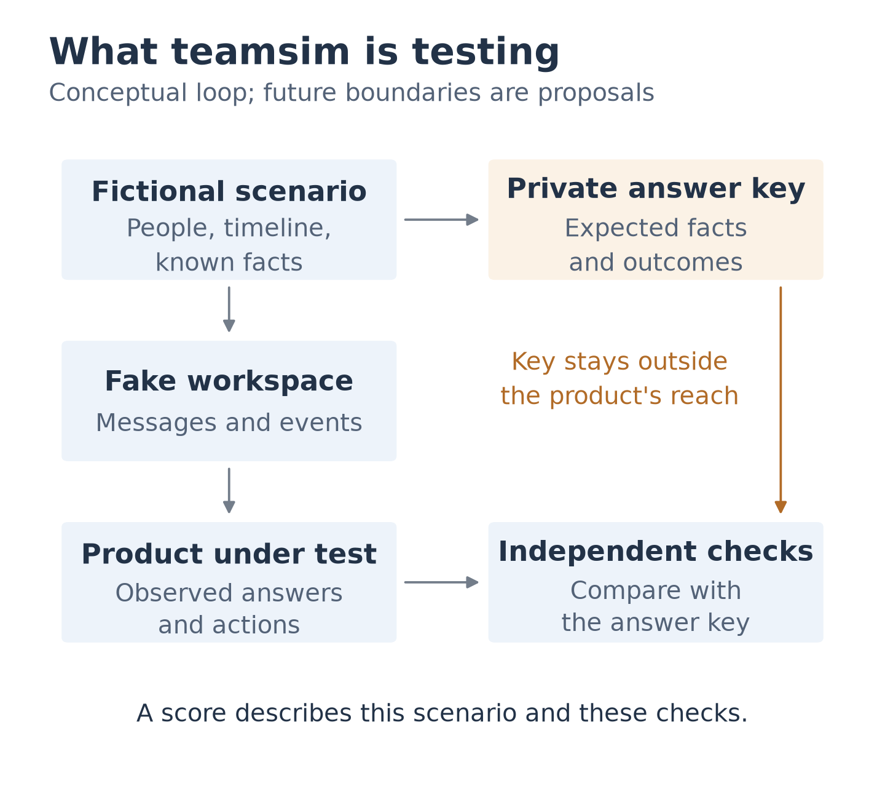
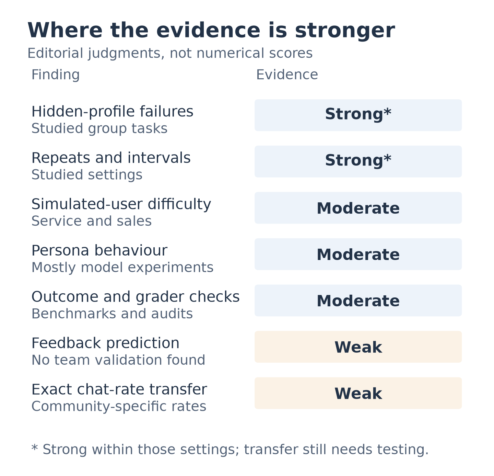
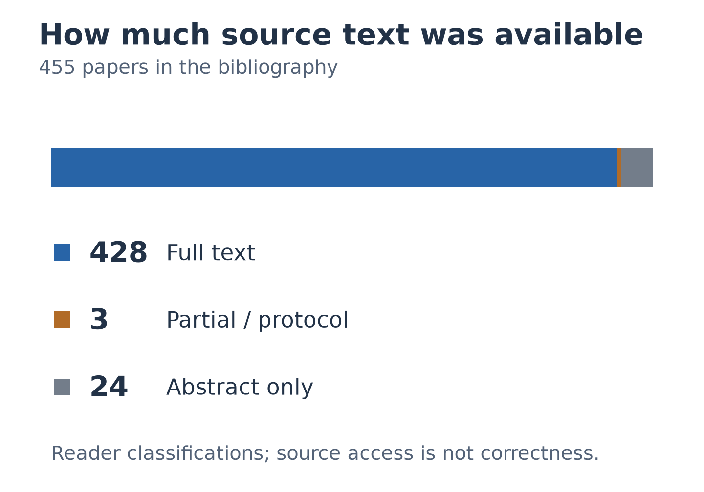
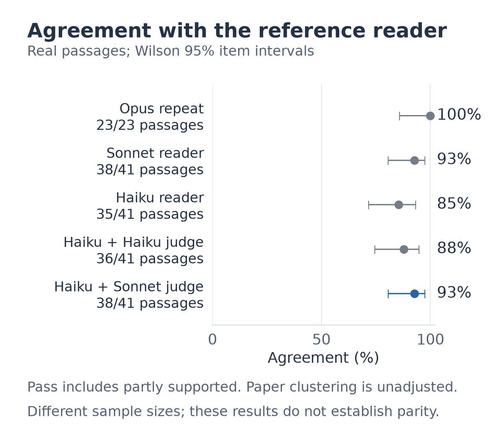
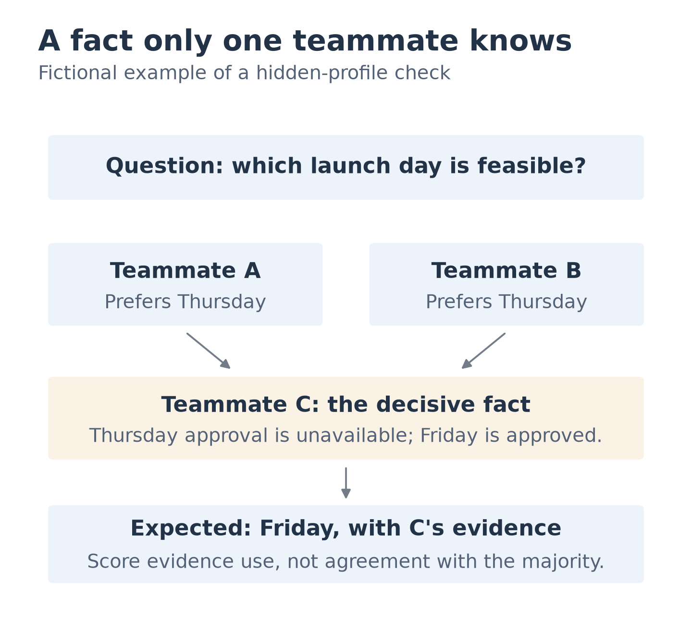
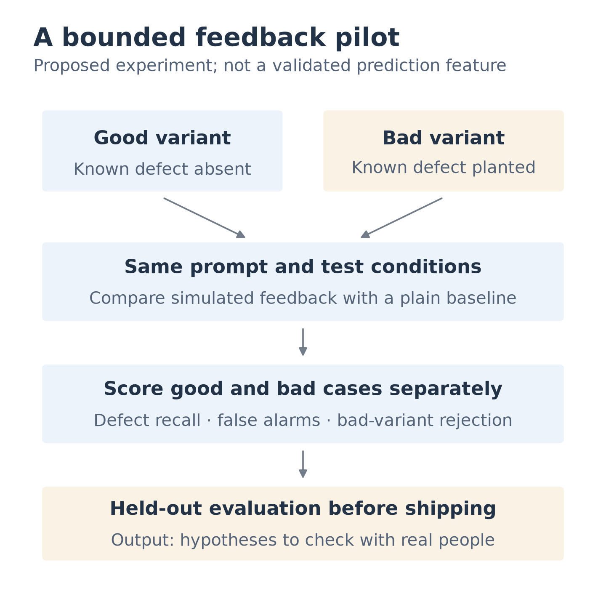

# The research, visually (2026-11-12)

Start here for the shape of teamsim, the strength of the evidence, and the decisions still
open. The figures summarise the [revised synthesis](2026-11-lit-synthesis.md) and
[full-text check](2026-11-lit-fulltext-check.md). Proposed designs are labelled; none changes
an accepted ADR.

1. [The testing loop](#1-the-testing-loop)
2. [Where the evidence is stronger](#2-where-the-evidence-is-stronger)
3. [What was actually read](#3-what-was-actually-read)
4. [What the reader benchmark shows](#4-what-the-reader-benchmark-shows)
5. [A concrete team scenario](#5-a-concrete-team-scenario)
6. [What simulated feedback would need to prove](#6-what-simulated-feedback-would-need-to-prove)

## 1. The testing loop

The simulator knows the planted facts before the product runs. A result describes the
covered scenario and checks; it does not establish human realism or general usefulness.
The boundary around the answer key is a design requirement, not a claim that every current
prototype boundary is already secure. [Design inputs and limits](2026-11-lit-synthesis.md#what-to-build-the-shape-the-literature-points-to).

## 2. Where the evidence is stronger

These are editorial grades of the findings in their measured settings. Even a strong result
in a puzzle, service conversation or statistical experiment needs a transfer check before
it becomes a claim about simulated teammates.
[Findings and source links](2026-11-lit-synthesis.md#what-the-literature-agrees-on).

## 3. What was actually read

The reader processed available text for 431 papers. Completeness is a reader classification,
not a separate human audit of every PDF. The initial review had 77 full reads; the current
per-paper status is in the [bibliography](bibliography/). Source access, quotation matching,
claim support and transfer are [different validation questions](2026-11-lit-fulltext-check.md#limits).

## 4. What the reader benchmark shows

The selected pipeline agreed on 38 of 41 real passages. The Opus repeat has fewer papers
and passages; the item intervals do not adjust for clustering within papers. A pass includes
`partly_supported`, so this comparison does not establish agreement on every needed edit
or demonstrate parity. [Definitions, costs and limitations](2026-11-lit-fulltext-check.md#benchmark).

## 5. A concrete team scenario

This is a fictional example, not a result from a cited study. It turns a hidden-profile
phenomenon into an observable test: does the product find and use the one decisive fact?
The original research concerns [distributed information in groups](2026-11-lit-team-dynamics.md),
not this launch scenario or a measured workplace failure rate.

## 6. What simulated feedback would need to prove

A panel praising a product is weak evidence. A useful pilot must find held-out defects,
avoid inventing defects in the good twin, and distinguish the two conditions. Its output
would remain hypotheses to check with real people. The gate and its thresholds are
[proposals for evaluation](2026-11-lit-synthesis.md#6-feedback-propose-a-bounded-pilot-after-scored-tests).

## Go deeper

| Visual question | Where to look |
|---|---|
| How did the paper check work? | [Review flow](2026-11-lit-fulltext-check.md#method) |
| How much did each reader configuration cost? | [Benchmark cost](2026-11-lit-fulltext-check.md#benchmark) |
| What did the models label, and what did editors actually change? | [Verdicts](2026-11-lit-fulltext-check.md#production-run) and [editorial decisions](2026-11-lit-fulltext-check.md#what-changed) |
| Why is matching a quotation insufficient? | [Validation layers](2026-11-lit-fulltext-check.md#limits) |
| What should an injection check observe? | [Delivery, actions and benign controls](2026-11-lit-product-checks.md) |
| How can the figures be inspected or regenerated? | [Figure data, sources and editable versions](figures/) |

The [synthesis's final section](2026-11-lit-synthesis.md#decisions-for-the-maintainer) lists
the open choices. The stack, model default, release scope and feedback pilot remain decisions
for the maintainer.
