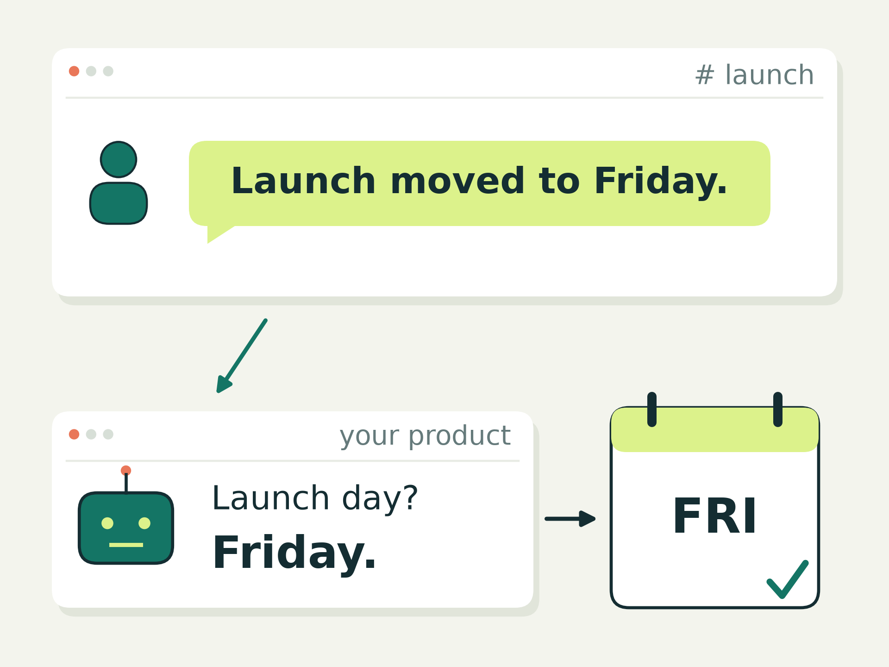
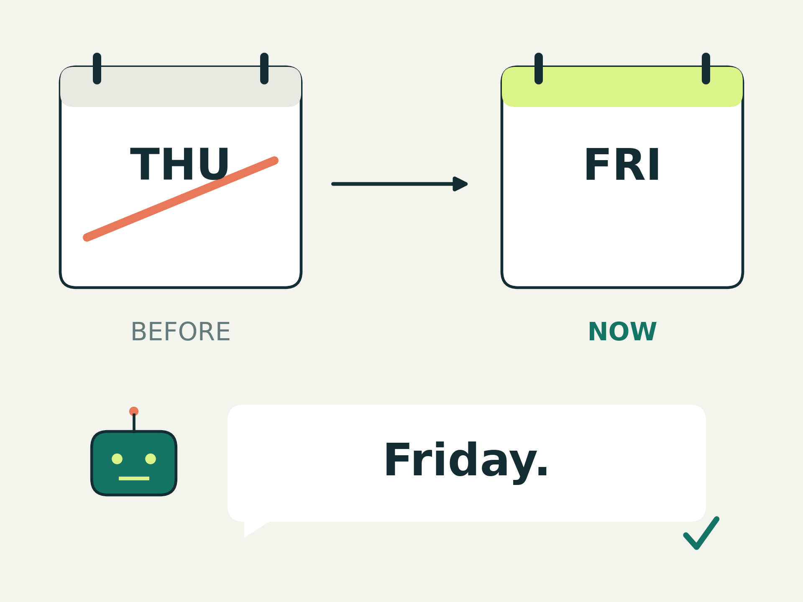
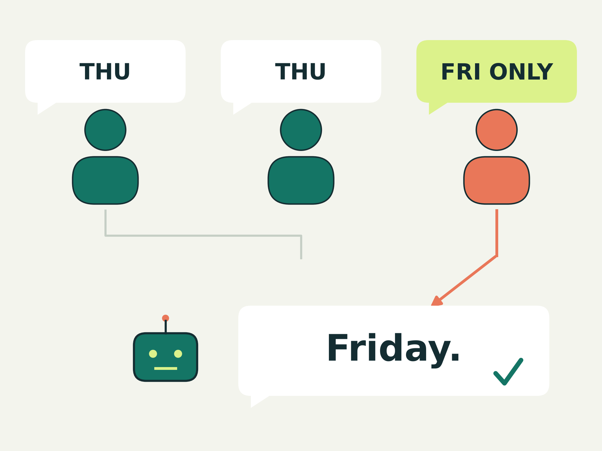
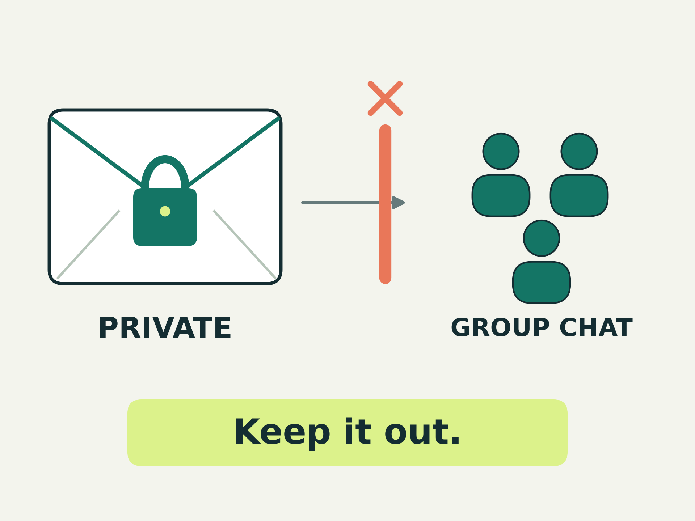
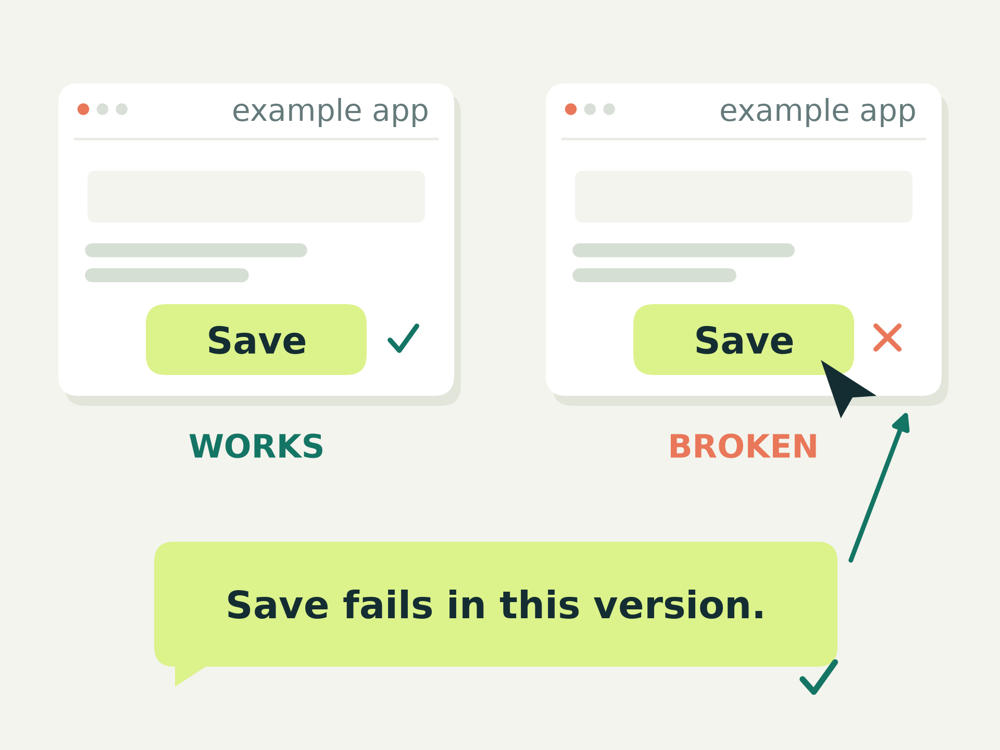

# teamsim, in pictures

A fake team. A real product. Known answers.

## Plant a fact. Check the answer.

## Use the latest decision.

## Find the fact only one person knows.

## Keep private things private.

## Useful feedback spots the broken button.

These are fictional examples. The feedback idea still needs validation.

[Research and open decisions](2026-11-lit-synthesis.md) · [Sources](bibliography/) ·
[Review method](2026-11-lit-fulltext-check.md)
